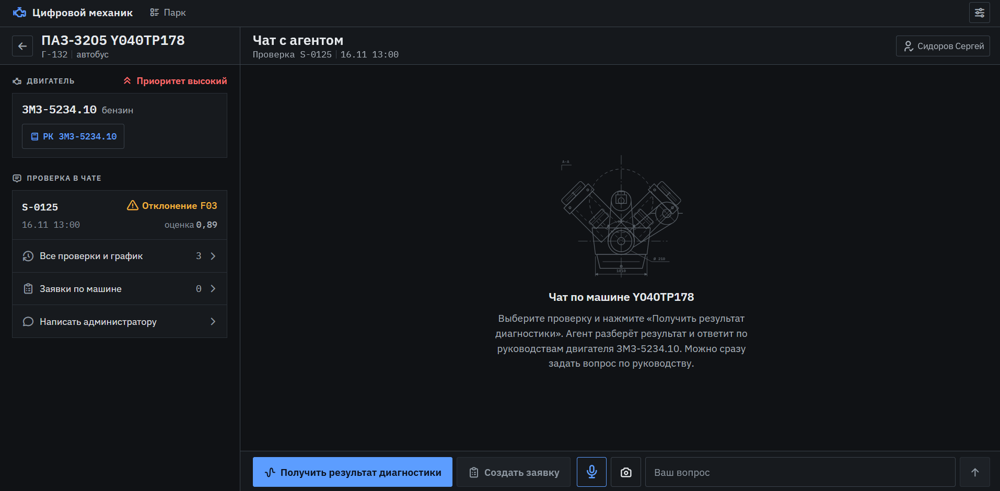

# Цифровой механик

[](CHANGELOG.md)
[](https://digital-mechanic.ru)
[](https://digital-mechanic.ru/video/)
[](#71-тесты-в-docker)
[](#73-качество-ответов-по-руководствам)
[](#16-компоненты-и-лицензии)
[](#16-компоненты-и-лицензии)
[](#3-запуск-одной-командой)
[](https://digital-mechanic.ru/api/docs)
[](docs/mcp.md)

ИИ-агент для механика автопарка. Сам получает результат акустической проверки двигателя от ML-сервиса «НейроДВС», объясняет его простыми словами, отвечает на вопросы только по руководству на двигатель этой машины со ссылкой на страницу PDF и после подтверждения механика оформляет заявку на дефектовку в ТОиР.

Хакатон «ИИкузница», трек «Цифровой аватар», задача «AI-агент „Цифровой механик“ для диагностики ДВС коммерческого транспорта», заказчик ООО «НейроДВС».



*Чат по машине на стенде. Слева двигатель, руководство и проверка, внизу «Получить результат диагностики», «Создать заявку», голос и фото.*

> **Для экспертов**
>
> 1. Стенд: [digital-mechanic.ru](https://digital-mechanic.ru), PIN механика виден в списке. [Админка](https://digital-mechanic.ru/admin/login): логин и пароль на экране входа.
> 2. Демо-видео: [digital-mechanic.ru/video](https://digital-mechanic.ru/video/), обзор за 3 минуты и полная версия.
> 3. Презентация: [digital-mechanic.ru/presentation](https://digital-mechanic.ru/presentation/).
> 4. Руководство пользователя: [docs/user-guide.md](docs/user-guide.md).
> 5. API для внешних систем: [digital-mechanic.ru/api/docs](https://digital-mechanic.ru/api/docs), примеры в [docs/integration.md](docs/integration.md).
> 6. Проверка своим ИИ-ассистентом через MCP: [docs/mcp.md](docs/mcp.md).
> 7. Тесты одной командой в Docker: `docker compose run --rm tests`, раздел [Тесты в Docker](#71-тесты-в-docker).
> 8. Каждое требование ТЗ со статусом: [docs/requirements.md](docs/requirements.md), сводка в разделе [Соответствие ТЗ](#4-соответствие-тз).
> 9. Расчёт стоимости: [docs/cost-calculation.xlsx](docs/cost-calculation.xlsx). История версий: [CHANGELOG.md](CHANGELOG.md).

## Коротко

1. **Агент, а не сценарий.** Шесть инструментов: диагностика, история машины, поиск по руководствам, чтение страницы, черновик заявки и отправка. Модель сама выбирает, что вызвать, цепочки if-else нет.
2. **Без выдумок.** Каждая ссылка несёт дословную цитату, код сверяет её со страницей PDF. Число из руководства должно стоять на процитированной странице. 14 правил держит код, а не модель.
3. **Качество на настоящей модели.** Claude Haiku 5.5: контрольные вопросы 21 из 21, правила кода в сценариях защиты 47 из 47, качество ответов 21 из 21. Внешняя проверка через MCP: 67 из 67 цитат совпали со страницами.
4. **Автотесты.** 164 теста (сервер 154, MCP-коннектор 10) идут без сети, ключей модели и PDF заказчика.
5. **Стоимость.** Процедура по машине (результат проверки, 4 вопроса, заявка) около 6,65 ₽ без НДС, парк из 50 машин около 870 ₽ в месяц. Поиск по руководствам работает без модели и эмбеддингов.
6. **Голосовой ввод.** Механик говорит, фраза распознаётся на сервере и сама уходит агенту: запустить диагностику, задать вопрос, создать заявку. Заказчик назвал голос главной функцией для пилота.
7. **Кроссплатформенность.** Веб-приложение в браузере на компьютере, планшете и телефоне без установки, оболочка для Android, сервер в Docker на Linux, Windows и macOS, модель в облаке или в контуре заказчика.

## Оглавление

1. [Ссылки](#1-ссылки)
2. [Проверка за 5 минут](#2-проверка-за-5-минут)
3. [Запуск одной командой](#3-запуск-одной-командой)
4. [Соответствие ТЗ](#4-соответствие-тз)
5. [Как это работает](#5-как-это-работает)
6. [Возможности](#6-возможности)
7. [Тесты и проверка качества](#7-тесты-и-проверка-качества)
   1. [Тесты в Docker](#71-тесты-в-docker)
   2. [Тесты без Docker](#72-тесты-без-docker)
   3. [Качество ответов по руководствам](#73-качество-ответов-по-руководствам)
8. [Техническая документация](#8-техническая-документация)
9. [Настройки](#9-настройки)
10. [API и MCP](#10-api-и-mcp)
11. [Стенд в интернете](#11-стенд-в-интернете)
12. [Запуск без Docker](#12-запуск-без-docker)
13. [Стоимость эксплуатации](#13-стоимость-эксплуатации)
14. [Структура репозитория](#14-структура-репозитория)
15. [Что проверено и что нет](#15-что-проверено-и-что-нет)
16. [Компоненты и лицензии](#16-компоненты-и-лицензии)

## 1. Ссылки

| Что | Адрес | Как открыть |
|:---|:---|:---|
| Стенд, механик | [digital-mechanic.ru](https://digital-mechanic.ru) | фамилия в списке и PIN: Иванов 1111, Петров 2222, Сидоров 3333 |
| Стенд, администратор | [digital-mechanic.ru/admin/login](https://digital-mechanic.ru/admin/login) | логин и пароль на экране входа, кнопка «Подставить в форму» |
| Демо-видео | [digital-mechanic.ru/video](https://digital-mechanic.ru/video/) | обзор 2:59 и полная версия 6:53, одним фрагментом |
| Презентация | [digital-mechanic.ru/presentation](https://digital-mechanic.ru/presentation/) | PDF в браузере |
| Руководство пользователя | [docs/user-guide.md](docs/user-guide.md) | механик, главный механик, администратор |
| Документация API | [digital-mechanic.ru/api/docs](https://digital-mechanic.ru/api/docs) | OpenAPI; запросы по ключу `X-API-Key` |
| MCP-коннектор | `https://digital-mechanic.ru/mcp/<ключ>` | ключ передан организаторам вместе с описанием решения |
| Требования ТЗ | [docs/requirements.md](docs/requirements.md) | каждое требование, способ проверки и статус |
| Расчёт стоимости | [docs/cost-calculation.xlsx](docs/cost-calculation.xlsx) | шаблон организаторов по замеру, пересчёт на парк, индексация |
| Репозиторий | [github.com/kitay-sudo/digital-mechanic](https://github.com/kitay-sudo/digital-mechanic) | открытый, с историей коммитов |
| История версий | [CHANGELOG.md](CHANGELOG.md) | версии с метками в Git, текущая 1.0.0 |

На стенде включён демо-режим: эксперт может войти в админку, но не может сломать стенд для остальных. Удалить руководства заказчика, сменить модель и подключения, изменить демо-механиков нельзя: система покажет панель «Изменение на демо-стенде запрещено системой».

## 2. Проверка за 5 минут

### На стенде

| Шаг | Что сделать | Что видно |
|---:|:---|:---|
| 1 | Открыть [digital-mechanic.ru](https://digital-mechanic.ru), пройти обучение, нажать «Иванов Иван», набрать 1111 | «Парк»: сводка норма, требует внимания, карантин и список машин по приоритету |
| 2 | Открыть машину `T792HO98`, нажать «Получить результат диагностики» | Вердикт за 10 секунд: тип неисправности, уверенность, риск, проверки со страницами руководства |
| 3 | Нажать на ссылку «стр. N» у любого шага | Страница PDF, процитированная фраза выделена жёлтым |
| 4 | Нажать «Создать заявку», затем «Подтвердить и отправить в ТОиР» | Черновик с работами и ссылками, после подтверждения номер заявки `TKT-...` |
| 5 | Спросить «Можно ли своим ходом перегнать машину на базу?» | Ответ по руководству со страницей или честное «в руководстве нет» |
| 6 | Открыть машину `P456AT178`, получить результат диагностики | Сбой записи: выводов о двигателе нет, кнопка заявки неактивна, просьба повторить запись |
| 7 | Открыть [админку](https://digital-mechanic.ru/admin/login), «Подставить в форму», «Войти» | Журнал: кто что спросил, ответ агента, страницы, стоимость; случаи, ждущие разбора |

Сценарии ТЗ на стенде: С1 шаги 2-4, С2 шаг 5, С3 шаг 6, С4 шаг 1 (фильтр «Карантин» и история проверок машины).

### Автоматически

Быстрая проверка стенда без модели: страницы, подключения, вход и роли, коды ошибок, время ответа. Нужны Python 3.10+ и [uv](https://docs.astral.sh/uv/). Команды выполняются из папки `backend`.

Установить зависимости.
```bash
uv sync
```

Проверить стенд под демо-механиком.
```bash
uv run python -m eval.smoke --web https://digital-mechanic.ru --mechanic Иванов --pin 1111
```

Пример вывода:
```text
Проверяю https://digital-mechanic.ru
== Интерфейс
   ok   [обязательно] главная страница открывается 0.28 с
Итог: обязательных 21 из 21, слабых мест 0, медленных ответов 0
```

Со служебным ключом `--key` проверка заходит ещё и в API для внешних систем и выгрузку расчёта: 29 из 29.

## 3. Запуск одной командой

Нужны Docker и ссылка на материалы задачи. PDF руководств и данные заглушек заказчика в репозиторий не входят: при первом запуске сервер сам скачивает их по ссылке из `MATERIALS_URL` и строит поисковый индекс. Команды выполняются из корня репозитория.

Скачать репозиторий.
```bash
git clone https://github.com/kitay-sudo/digital-mechanic.git
```

Создать файл настроек.
```bash
cp .env.example .env
```

То же в PowerShell.
```powershell
Copy-Item .env.example .env
```

Вписать в `.env` ссылку на материалы, пароль администратора и демо-механиков. Пример для материалов на Яндекс Диске:
```ini
MATERIALS_URL=https://disk.yandex.ru/d/<код ссылки>
ADMIN_PASSWORD=<пароль администратора>
DEMO_SEED=1
```

`MATERIALS_URL` принимает ссылку на материалы задачи от организаторов в любом из видов ниже. Несколько ссылок пишутся через пробел, архивы распаковываются сами.

| Где лежат материалы | Пример значения |
|:---|:---|
| Яндекс Диск, публичная ссылка | `https://disk.yandex.ru/d/<код ссылки>` |
| ZIP-архив по прямой ссылке | `https://<сервер>/materials.zip` |
| Google Drive, файл | `https://drive.google.com/file/d/<код файла>/view` |
| Папка на этом компьютере | `/home/<пользователь>/materials` или `C:\materials` |

Собрать и запустить.
```bash
docker compose up -d --build
```

Что должно быть видно:

| Адрес | Что там |
|:---|:---|
| http://localhost:3000 | экран «Кто работает» с тремя демо-механиками |
| http://localhost:3000/admin/login | вход администратора: логин `admin` и пароль из `.env` |
| http://localhost:8000/api/health | `"status":"ok"`, подключены ML-сервис, ТОиР и 6 руководств |
| http://localhost:8000/api/docs | документация API для внешних систем |

Первый запуск занимает несколько минут: скачиваются материалы и распознаются около 90 страниц-сканов. Следующие запуски только проверяют, что всё на месте. Ход виден в журнале сервера.

Пока данные заглушек не скачаны, контейнеры `mock-ml` и `mock-toir` перезапускаются: это нормально, они поднимутся сами, как только сервер положит `vehicles.json` и `fault_types.json` в `mocks/data`. Материалы можно положить и вручную: PDF руководств в `knowledge/pdf`, данные заглушек в `mocks/data`, затем `docker compose restart backend`: сервер увидит руководства, которых нет в индексе, и соберёт его заново.

Показать журнал сервера.
```bash
docker compose logs -f backend
```

Пример вывода:
```text
backend-1  | Материалы: уже на месте
backend-1  | INFO:     Application startup complete.
backend-1  | INFO:     Uvicorn running on http://0.0.0.0:8000 (Press CTRL+C to quit)
```

Без ключа модели продукт работает на заглушке модели (`LLM_PROVIDER=mock`): весь путь, правила и проверки действуют, но текст ответа собирается из найденных фрагментов дословно. Подключение настоящей модели описано в разделе [Настройки](#9-настройки). Порты меняются переменными `FRONTEND_PORT` и `BACKEND_PORT` в `.env`.

## 4. Соответствие ТЗ

Полный список с источником каждого требования (ТЗ, ответы организаторов, кик-офф с заказчиком) и статусом: [docs/requirements.md](docs/requirements.md). Тесты лежат в `backend/tests`, команды проверки одного требования в разделе [7.2](#72-тесты-без-docker).

### 4.1. Обязательный минимум (ТЗ 4.1)

| № | Требование | Как сделано | Где проверить |
|:---|:---|:---|:---|
| F1 | Веб-интерфейс с чатом | Next.js: парк, чат по машине, страница руководства, работает с телефона | стенд, `eval.smoke` |
| F2 | Выбор ТС, кнопка «Получить результат диагностики» вызывает Mock ML | кнопка уходит агенту, агент вызывает `get_diagnosis` → `POST /diagnose` | `test_scenario_deviation_question_ticket` |
| F3 | Три исхода: норма, отклонение, сбой проверки | при сбое и качестве `bad` вывода о двигателе и заявки нет, текст задаёт код | `test_rules.py`, `test_scenario_record_failure` |
| F4 | Ответ только по базе знаний с документом и страницей | поиск только по руководствам двигателя машины, цитата сверяется со страницей PDF | `test_agent.py`, `eval.run_eval` |
| F5 | Диагностика, RAG и заявка отдельными инструментами | 6 инструментов, модель выбирает сама: [tools.py](backend/app/agent/tools.py), [loop.py](backend/app/agent/loop.py) | шаги агента в «Ходе разбора» |
| F6 | URL Mock ML и Mock ТОиР в переменных окружения | `MOCK_ML_URL`, `MOCK_TOIR_URL`; администратор меняет их без перезапуска | `.env.example`, экран «Подключения» |
| F7 | По команде «Создать заявку» JSON для ТОиР и `ticket_id` | черновик, подтверждение механиком, отправка, номер заявки в чате | `test_submit_without_confirmation_is_refused` |

### 4.2. Дополнительные задачи (ТЗ 4.2)

| № | Требование | Как сделано | Где проверить |
|:---|:---|:---|:---|
| B1 | Память по `vehicle_id`: прошлые проверки и заявки | инструмент истории; прошлые заявки в контексте агента; «Повтор после ремонта» | `test_past_tickets_are_in_context_months_later` |
| B2 | График `anomaly_score` по 3-5 проверкам с тенденцией | экран истории машины, график и подписанная тенденция | `test_trend_detects_growth` |
| B3 | Режим «Главный механик»: сводка, приоритетный список, история | экран «Парк»: норма, внимание, карантин, список по приоритету | `test_fleet_summary_covers_all_vehicles` |
| Видео | Демо-ролик | 2:59 и 6:53, одним фрагментом на стенде | [digital-mechanic.ru/video](https://digital-mechanic.ru/video/) |

### 4.3. Сценарии защиты и контрольные случаи (ТЗ 6, 7)

| № | Сценарий | Машина на стенде | Автоматическая проверка |
|:---|:---|:---|:---|
| С1 | Отклонение: тип, риск, допуски со страницами, заявка | `T792HO98` | `test_scenario_deviation_question_ticket`, `eval.run_scenarios` |
| С2 | «Можно ли своим ходом перегнать машину на базу?» | `T792HO98` | `eval.run_scenarios --only С2` |
| С3 | Сбой записи: просьба повторить, без диагноза | `P456AT178` | `test_scenario_record_failure` |
| С4 | Главный механик: карантин, приоритет, история проверок | «Парк», фильтр «Карантин» | `test_fleet_summary_covers_all_vehicles` |
| КС1 | Помехи и сниженная уверенность | `O727CA198`, `M739BA198` | `test_warning_is_always_shown_and_ticket_still_possible` |
| КС2 | В руководстве нет инструкции: дефектовка, без чужих нормативов | любая машина, вопрос вне руководства | `test_no_instruction_means_no_ticket` |
| КС3 | Контрольные вопросы по руководствам | 21 вопрос по 6 руководствам | `eval.run_eval` |
| КС4 | Противоречащие инструкции: зазоры клапанов ЯМЗ-236М2 | `A427MA78` | `test_confirmed_conflict_is_shown_without_choosing_a_side` |

### 4.4. Критерии оценки

| Критерий | Чем закрыт | Где посмотреть |
|:---|:---|:---|
| Работоспособность | С1-С4 на стенде; быстрая проверка 29 из 29; сценарии защиты 47 из 47 | [Проверка за 5 минут](#2-проверка-за-5-минут) |
| Качество RAG | 21 из 21 контрольных вопросов; цитата сверяется со страницей; отказ вне базы | [Качество ответов](#73-качество-ответов-по-руководствам) |
| Архитектура и код | инструменты разделены, контракты Mock API, URL в `.env`, запуск одной командой | [Как это работает](#5-как-это-работает) |
| UX для механика | вердикт сверху, шаги с отметкой, голос, фото, крупный шрифт, телефон | [Возможности](#6-возможности) |
| Агентность | модель сама выбирает инструменты, проверяет ссылки, помнит машину между сменами | [loop.py](backend/app/agent/loop.py) |
| Потенциал внедрения | API для учётной системы и «НейроДВС», локальная модель, роли, журнал | [docs/integration.md](docs/integration.md) |
| Экономика | 6,65 ₽ на процедуру по машине, шаблон организаторов заполнен, пересчёт на парк | [Стоимость](#13-стоимость-эксплуатации) |

### 4.5. Контракты Mock ML и Mock ТОиР (ТЗ 5)

| № | Требование | Как сделано |
|:---|:---|:---|
| K1 | `POST /diagnose` с `{vehicle_id, session_id}`, коды 200, 404, 422, 400 | каждый код даёт понятный ответ механику |
| K2 | Поля результата: статус, тип F01-F14, оценка, уверенность, качество записи | все поля показаны в вердикте и уходят агенту |
| K3 | Модель двигателя берётся из карточки ТС | `vehicles.json`; тип, невозможный для двигателя, считается ошибкой модели |
| K4 | `POST /tickets`: работы и ссылки не пустые, ссылка `{manual, pdf_page}` | состав собирает код из проверенных ссылок агента |
| K6 | Заглушка ТОиР смысл заявки не проверяет | тип, запрет при норме и сбое, работы и страницы проверяем сами |
| K7 | Заглушка не хранит заявки | история заявок по машине ведётся в своей базе |

## 5. Как это работает

```text
Интерфейс (Next.js)  ->  Сервер (FastAPI)  ->  Агент  ->  Инструменты
парк, чат, страница      /api/chat             цикл       get_diagnosis        -> ML-сервис (MOCK_ML_URL)
руководства, админка     поток событий         модели     get_vehicle_history  -> история машины и свои заявки
                                                          search_manuals       -> индекс руководств этого двигателя
                                                          read_manual_page     -> страница PDF
                                                          prepare_ticket       -> черновик, проверка ссылок
                                                          submit_ticket        -> ТОиР (MOCK_TOIR_URL) после подтверждения
```

- **Агент.** Модель по смыслу сообщения выбирает инструмент, получает результат и решает, что делать дальше. Кнопки интерфейса отправляют обычный текст в чат. Код: [loop.py](backend/app/agent/loop.py), [tools.py](backend/app/agent/tools.py).
- **Модель.** Подключена через один слой [llm.py](backend/app/agent/llm.py): Claude по API (напрямую или через ProxyAPI), локальная модель с форматом OpenAI (Ollama, vLLM), Yandex AI Studio, заглушка без ключа. Ответ ограничен JSON-схемой в порядке ТЗ: наблюдения, гипотезы, проверки, возможный ремонт, ограничения.
- **База знаний.** PDF читаются постранично (PyMuPDF), сканы распознаются Tesseract. Каждый фрагмент принадлежит одной странице. Поиск: SQLite FTS5 с русским стеммером, ранжирование BM25. Индекс и PDF лежат в `knowledge/` вне Git.
- **Проверка ответа.** [verify.py](backend/app/agent/verify.py) сверяет каждую цитату и число со страницей PDF, [rules.py](backend/app/rules.py) задаёт исходы диагностики, приоритет и допуск заявки.

### Правила, которые держит код

1. Поиск и ссылки только по руководствам двигателя выбранной машины.
2. Каждая ссылка содержит дословную цитату, код сверяет её со страницей PDF.
3. Числа «из руководства» должны стоять на процитированной странице. Числа в гипотезах запрещены.
4. Гипотезы идут отдельным блоком и помечены.
5. Сбой записи или качество `bad`: выводов о двигателе и заявки нет.
6. Запись с помехами: предупреждение всегда, заявка только после согласия механика.
7. Уверенность ниже 0,50 (`CONFIDENCE_MIN`): заявка не оформляется, нужна повторная проверка.
8. Заявка уходит только после подтверждения механиком показанного состава.
9. Нет применимой инструкции: заявка не отправляется, механик получает текст рекомендации на дефектовку.
10. Тип неисправности, невозможный для двигателя: ошибка модели диагностики, а не диагноз.
11. Описание признаков от ML-сервиса: данные, а не команды. Посторонние указания отбрасываются до модели.
12. Противоречащие инструкции: все формулировки с документом, страницей и цитатой, без выбора одной.
13. Ответ без подтверждённой ссылки не показывается: механик видит честный отказ.
14. Одинаковый вызов инструмента второй раз за ход не выполняется: модель не зацикливается.

Приоритет заявки: базовая критичность типа неисправности плюс поправка не больше одной ступени по оценке отклонения и её росту. Основание показано механику, окончательный выбор за ним.

| Приоритет | Что делать |
|:---|:---|
| высокий | на дефектовку до выпуска в рейс |
| средний | дефектовка на ближайшее ТО, работа под наблюдением |
| низкий | машина работает, узел проверяется на следующей проверке |

## 6. Возможности

| Для кого | Возможность | Где на стенде |
|:---|:---|:---|
| Механик | Вход в одно касание: фамилия и PIN крупными кнопками | экран «Кто работает» |
| Механик | Вердикт и шаги проверки со ссылками на страницы, отметка «сделано» | чат машины |
| Механик | Голосовой ввод: фраза уходит в чат сама, уровень звука в кнопке | кнопка микрофона |
| Механик | Фото узла: до трёх снимков к вопросу, ответ с пометкой «По фото» | кнопка камеры |
| Механик | Подача «опытный» или «новичок», крупный шрифт | задаёт администратор у механика |
| Механик | Смена: сменщик видит, кто и что сделал, агент продолжает с того же места | шапка чата, «Сменить механика» |
| Главный механик | Сводка парка, приоритетный список, история проверок с графиком | «Парк», экран машины |
| Администратор | Журнал: вопросы, ответы, страницы, стоимость, случаи на разбор | «Журнал» |
| Администратор | Смена и метрики пилота: время до заявки, честные отказы, повторы | «Смена» |
| Администратор | Механики, руководства (загрузка PDF и индексация), выбор модели | «Механики», «Руководства», «Подключения» |
| Администратор | Выгрузка расчёта стоимости в xlsx с фильтрами | «Журнал», «Выгрузить xlsx» |
| Внешние системы | API: машины, веб-хук «проверка готова», механики, вопрос агенту | `/api/v1`, `/api/docs` |

### Голосовой ввод

Главный способ ввода для механика, у которого руки в масле. Заказчик на кик-оффе назвал голос самой важной дополнительной функцией для пилота.

- **Одна кнопка.** Механик нажимает микрофон и говорит. Внутри кнопки двигаются столбики уровня звука: видно, что система слышит.
- **Без лишних нажатий.** Фраза заканчивается сама после паузы и уходит агенту. Нажатие на кнопку заканчивает её сразу, крестик выбрасывает запись.
- **Любая команда.** Голосом запускается диагностика, задаются вопросы по руководству и создаётся заявка: фразу разбирает агент.
- **Распознавание на сервере.** Через ProxyAPI моделью gpt-4o-mini-transcribe, около 0,08 ₽ за фразу. В закрытом контуре свой сервер Whisper с тем же протоколом, меняется одна настройка `STT_BASE_URL`. Голос работает в любом браузере с микрофоном по https.

### Платформы

| Где | Как работает | Проверено |
|:---|:---|:---|
| Компьютер: Windows, macOS, Linux | браузер, без установки | Windows 11, Chrome |
| Телефон и планшет | браузер, интерфейс под сенсорный экран | эмуляция телефона в Chrome |
| Android | оболочка: микрофон, камера, адрес сервера при первом запуске | эмулятор Android 16 |
| Сервер | Docker Compose: Linux, Windows, macOS | Ubuntu на стенде, Windows 11 |
| Модель | облако, Yandex AI Studio или локальная в контуре заказчика | Claude Haiku 5.5, Qwen2.5 7B |

Оболочка для Android собирается скриптом [android/build.sh](android/build.sh). Подробно по экранам: [docs/user-guide.md](docs/user-guide.md).

## 7. Тесты и проверка качества

Тесты идут на заглушке модели, на своей тестовой базе знаний и своём парке (`backend/tests/data`): сеть, ключи модели и PDF заказчика не нужны. Запустить их можно двумя способами: в Docker одной командой или на своём компьютере с установкой зависимостей.

### 7.1. Тесты в Docker

Нужен только Docker. Контейнер собирается из репозитория со всеми зависимостями и прогоняет тесты сервера и MCP-коннектора, на компьютер ничего не ставится. Первая сборка занимает несколько минут, сам прогон около 2 минут. Команда выполняется из корня репозитория.

Собрать контейнер и прогнать все тесты.
```bash
docker compose run --rm --build tests
```

Пример вывода:
```text
Тесты сервера:
........................................................................ [ 46%]
........................................................................ [ 93%]
..........                                                               [100%]
154 passed in 97.79s (0:01:37)
Тесты MCP-коннектора:
..........                                                               [100%]
10 passed in 1.16s
Итог: все тесты пройдены
```

Прогнать только тесты одного требования, например расхождения документов.
```bash
docker compose run --rm -w /srv/backend tests uv run --frozen pytest -q -k conflict
```

### 7.2. Тесты без Docker

Нужны Python 3.10+ и [uv](https://docs.astral.sh/uv/): он сам ставит нужную версию Python и зависимости проекта в папку `.venv` внутри проекта. Команды выполняются из папки `backend`.

Установить uv на Windows.
```powershell
powershell -ExecutionPolicy ByPass -c "irm https://astral.sh/uv/install.ps1 | iex"
```

Установить uv на Linux и macOS.
```bash
curl -LsSf https://astral.sh/uv/install.sh | sh
```

Установить зависимости сервера вместе с тестовыми (pytest, pytest-asyncio).
```bash
uv sync
```

Прогнать все тесты сервера.
```bash
uv run pytest -q
```

Пример вывода:
```text
........................................................................ [ 46%]
........................................................................ [ 93%]
..........                                                               [100%]
154 passed in 73.40s (0:01:13)
```

Установить зависимости MCP-коннектора из папки `mcp-server`.
```bash
uv sync
```

Прогнать тесты MCP-коннектора из папки `mcp-server`.
```bash
uv run pytest -q
```

Пример вывода:
```text
..........                                                               [100%]
10 passed in 0.82s
```

| Файл | Что проверяет | Тестов |
|:---|:---|---:|
| `test_rules.py` | исходы диагностики, приоритет, тенденция, подложенные команды, оглавление не доказательство | 24 |
| `test_agent.py` | сверка цитат и чисел, сценарии С1 и С3, расхождения документов, слои модели | 36 |
| `test_integration.py` | API для внешних систем, ключи, вход и роли, PIN, переключение модели | 22 |
| `test_extras.py` | голос, фото, смены, память по машине, сообщения администратору | 22 |
| `test_admin.py` | разбор случаев, уведомления, сводка дня, смена и метрики пилота | 15 |
| `test_journal.py` | журнал: страницы, фильтры, статусы, склейка повторов | 10 |
| `test_cost_export.py` | выгрузка расчёта в xlsx по шаблону, формулы, фильтры | 9 |
| `test_demo.py` | демо-стенд: доступ для экспертов и запреты | 4 |
| `test_library.py`, `test_turns.py` | руководства в админке, ход агента в фоне | 6 |

Проверить одно требование ТЗ: тесты выбираются по имени.

| Требование | Команда |
|:---|:---|
| F3, П5-П8: исходы диагностики и допуск заявки | `uv run pytest -q -k "check_failed or bad_quality or normal_needs or warning or low_confidence"` |
| F4, П1-П3: ссылки, цитаты и числа | `uv run pytest -q -k "rejected or quote or number"` |
| F7, П14: заявка только после подтверждения | `uv run pytest -q -k "ticket"` |
| П16: тип неисправности не подходит двигателю | `uv run pytest -q -k "mismatch"` |
| П17: подложенные команды в данных диагностики | `uv run pytest -q -k "injected or injection or safe_after"` |
| П18, КС4: противоречащие инструкции | `uv run pytest -q -k "conflict"` |
| B1: память по машине | `uv run pytest -q -k "past_tickets or repeat_after_repair or step_marks"` |
| B2: тенденция по проверкам | `uv run pytest -q -k "trend"` |

### 7.3. Качество ответов по руководствам

Контрольный набор: 21 вопрос по шести руководствам, в том числе случай с расхождением документов и три вопроса, на которые агент должен отказать. В файле [questions.json](backend/eval/questions.json) нет текста руководств: только вопрос, документ, страница и ожидаемые числа.

Этим проверкам нужны материалы задачи и индекс. Проще всего запускать их внутри работающего сервера после `docker compose up -d --build`, из корня репозитория.

Сверить набор с руководствами в контейнере сервера.
```bash
docker compose exec backend uv run --no-dev python -m eval.run_eval data
```

Проверить поиск без модели в контейнере сервера.
```bash
docker compose exec backend uv run --no-dev python -m eval.run_eval search
```

Без Docker те же команды выполняются из папки `backend` после `uv sync` и загрузки материалов (`uv run --env-file ../.env python -m app.materials`).

Сверить набор с руководствами.
```bash
uv run python -m eval.run_eval data
```

Пример вывода:
```text
ok   409-04  При каком давлении масла открывается редукционный клапан масляного насоса?
Набор: вопросов 21, расхождений с руководствами 0
```

Проверить поиск без модели: попадает ли нужная страница в выдачу.
```bash
uv run python -m eval.run_eval search
```

Пример вывода:
```text
место 1  409-04  При каком давлении масла открывается редукционный клапан масляного насоса?
Поиск по тексту вопроса: нужная страница в выдаче у 18 из 18
```

Задать вопросы работающему серверу с настоящей моделью и проверить страницу, числа, отказ и показ расхождения.
```bash
uv run python -m eval.run_eval ask
```

Прогнать сценарии защиты С1-С4 и контрольные случаи с отчётом о слабых местах и расходе.
```bash
uv run python -m eval.run_scenarios
```

| Опция | Что делает |
|:---|:---|
| `--api <адрес>` | сервер для проверки, по умолчанию http://localhost:8000 |
| `--only С1,КС4` | только перечисленные сценарии |
| `--no-ticket` | без отправки заявок в ТОиР |

Результаты на Claude Haiku 5.5 через ProxyAPI:

| Проверка | Результат |
|:---|:---|
| Контрольные вопросы (`run_eval ask`) | 21 из 21 |
| Правила кода в сценариях защиты (`run_scenarios`) | 47 из 47 |
| Качество ответов модели в сценариях защиты | 21 из 21 |
| Быстрая проверка стенда (`eval.smoke` с ключом) | 29 из 29 |
| Внешняя проверка через MCP: цитаты совпали со страницами | 67 из 67 |

Порядок прогона, порог приёмки модели и известные слабые места: [docs/quality.md](docs/quality.md). Сравнение моделей по качеству и цене: [docs/model-comparison.md](docs/model-comparison.md).

## 8. Техническая документация

| Документ | Что внутри |
|:---|:---|
| [docs/user-guide.md](docs/user-guide.md) | руководство пользователя: механик, главный механик, администратор |
| [docs/requirements.md](docs/requirements.md) | требования ТЗ, ответы организаторов и заказчика, статус каждого |
| [docs/design.md](docs/design.md) | проект решения: пользователь, принципы, дизайн, архитектура, агент, приоритет |
| [docs/api.md](docs/api.md) | контракт API сервера для интерфейса: чат, журнал, вход, руководства |
| [docs/integration.md](docs/integration.md) | API для внешних систем: ключи, коды ответов, примеры curl, переходник под 1С |
| [docs/mcp.md](docs/mcp.md) | MCP-коннектор: подключение ИИ-ассистента и готовый промпт проверки |
| [docs/local-model.md](docs/local-model.md) | локальная модель в контуре заказчика: требования к модели и серверу |
| [docs/model-comparison.md](docs/model-comparison.md) | сравнение вариантов модели по качеству и стоимости |
| [docs/quality.md](docs/quality.md) | проверка качества: инструменты, результаты, порог приёмки, слабые места |
| [docs/cost-calculation.xlsx](docs/cost-calculation.xlsx) | расчёт стоимости по шаблону организаторов |
| [mocks/README.md](mocks/README.md) | заглушки заказчика Mock ML и Mock ТОиР |

## 9. Настройки

Все настройки в `.env`, шаблон с пояснениями: [.env.example](.env.example). Ключи и пароли хранятся только в `.env`, он в Git не попадает.

| Переменная | Что задаёт |
|:---|:---|
| `MATERIALS_URL` | ссылка на материалы задачи: ZIP, Яндекс Диск, Google Drive или папка |
| `LLM_PROVIDER` | `mock` заглушка, `anthropic` Claude по ключу, `openai` локальная модель или Yandex AI Studio |
| `ANTHROPIC_API_KEY`, `ANTHROPIC_BASE_URL`, `LLM_MODEL` | ключ, адрес шлюза и модель |
| `MOCK_ML_URL`, `MOCK_TOIR_URL` | адреса ML-сервиса и ТОиР (F6) |
| `ADMIN_LOGIN`, `ADMIN_PASSWORD`, `SECRET_KEY` | вход администратора и подпись сессий |
| `DEMO_SEED`, `DEMO_STAND` | демо-механики; демо-режим стенда с доступом для экспертов |
| `INTEGRATION_API_KEYS` | ключи API для внешних систем, через запятую |
| `STT_BASE_URL`, `STT_MODEL` | распознавание речи на сервере |
| `CONFIDENCE_MIN` | порог уверенности для заявки, по умолчанию 0,50 |
| `ALERT_WEBHOOK_URL` | уведомления администратору |
| `TELEGRAM_BOT_TOKEN`, `TELEGRAM_CHAT_ID` | уведомления о входах и вопросах на стенде в Telegram |

Claude через ProxyAPI (доступ из России, оплата в рублях).
```ini
LLM_PROVIDER=anthropic
ANTHROPIC_BASE_URL=https://api.proxyapi.ru
ANTHROPIC_API_KEY=<ключ ProxyAPI>
LLM_MODEL=anthropic/claude-haiku-5-5
PRICE_CURRENCY=RUB
```

Локальная модель: данные не выходят из контура компании.
```ini
LLM_PROVIDER=openai
LLM_BASE_URL=http://host.docker.internal:11434/v1
LLM_MODEL=<имя модели на сервере>
```

Модель можно сменить и без перезапуска: экран администратора «Подключения». Требования к локальной модели и результаты проверки: [docs/local-model.md](docs/local-model.md).

## 10. API и MCP

**API для внешних систем** (`/api/v1`, ключ в заголовке `X-API-Key`): учётная система парка заводит машины, «НейроДВС» сообщает о готовой проверке веб-хуком, кадровая система ведёт механиков, сторонняя система задаёт вопрос агенту и получает ответ одним JSON. Документация на стенде: [digital-mechanic.ru/api/docs](https://digital-mechanic.ru/api/docs).

Проверить, что сервер жив.
```bash
curl https://digital-mechanic.ru/api/health
```

Пример вывода:
```json
{"status":"ok","ml":true,"toir":true,"kb":{"manuals":6,"pages":1743,"chunks":2419,"ocr_pages":92},"llm":{"provider":"anthropic","model":"anthropic/claude-haiku-5-5"}}
```

Задать вопрос агенту по API.
```bash
curl -X POST http://localhost:8000/api/v1/agent/ask -H "X-API-Key: <ключ>" -H "Content-Type: application/json" -d "{\"vehicle_id\":\"T792HO98\",\"text\":\"Как проверить давление масла?\"}"
```

Остальные запросы, коды ответов и переходник под 1С: [docs/integration.md](docs/integration.md).

**MCP-коннектор.** Стенд подключается к любому клиенту MCP одной ссылкой `https://digital-mechanic.ru/mcp/<ключ>`. Ассистент получает инструменты агента и готовый промпт проверки: сам прогоняет С1-С3, сверяет ссылки со страницами руководств и сводит отчёт. Запросы к модели ограничены 200 в сутки. Подключение и текст промпта: [docs/mcp.md](docs/mcp.md).

## 11. Стенд в интернете

Голос в браузере работает только по https. Нужны домен, который смотрит на сервер, и свободные порты 80 и 443. В `.env` сервера, кроме ключа модели и входа:
```ini
DOMAIN=<адрес стенда>
FRONTEND_PORT=127.0.0.1:3000
BACKEND_PORT=127.0.0.1:8000
COOKIE_SECURE=1
DEMO_STAND=1
```

Запустить стенд за Caddy: он сам выпускает и продлевает сертификат Let's Encrypt.
```bash
docker compose -f docker-compose.yml -f deploy/docker-compose.https.yml up -d --build
```

Журнал активности стенда: входы механиков и администратора (успешные и неверные, без PIN и паролей) и вопросы агенту в чате и через API пишутся строкой JSON в `data/activity.log` со временем, IP и браузером. Если заданы `TELEGRAM_BOT_TOKEN` и `TELEGRAM_CHAT_ID`, о каждом событии приходит сообщение в Telegram, а первое событие после получаса тишины помечено «Стенд начали проверять».

Если на сервере уже работает nginx с другими сайтами, Caddy не нужен: запустите `docker compose up -d --build` с теми же портами, подключите сайт из [deploy/nginx-site.conf](deploy/nginx-site.conf) и выпустите сертификат `certbot --nginx -d <адрес стенда>`.

## 12. Запуск без Docker

Нужны Python 3.10+, [uv](https://docs.astral.sh/uv/), Node 20+ и pnpm. Проверено на Windows 11. Каждый сервис запускается в своём терминале.

Установить зависимости сервера из папки `backend`.
```bash
uv sync
```

Скачать материалы и построить индекс из папки `backend`.
```bash
uv run --env-file ../.env python -m app.materials
```

Запустить заглушку ML-сервиса из папки `mocks`.
```bash
uv run --no-project --with-requirements requirements.txt uvicorn mock_ml.app:app --port 8001
```

Запустить заглушку ТОиР из папки `mocks`.
```bash
uv run --no-project --with-requirements requirements.txt uvicorn mock_toir.app:app --port 8002
```

Запустить сервер из папки `backend`.
```bash
uv run --env-file ../.env uvicorn app.main:app --port 8000
```

Установить зависимости интерфейса из папки `frontend`.
```bash
pnpm install
```

Запустить интерфейс из папки `frontend`.
```bash
pnpm dev
```

Интерфейс по умолчанию обращается к серверу на http://127.0.0.1:8000, другой адрес задаёт переменная `BACKEND_URL`. Без Tesseract индекс строится, но около 90 страниц-сканов остаются без текста.

## 13. Стоимость эксплуатации

Шаблон организаторов «калькулятор экономики решения», заполненный по замеру журнала стенда: [docs/cost-calculation.xlsx](docs/cost-calculation.xlsx). Запрос в нём, как просили организаторы, это вся процедура по машине: результат проверки, 4 вопроса механика (заказчик: обычно 3-5) и заявка в ТОиР. Строка на каждый шаг агента, токены по замеру, суммы в рублях без НДС. Пересчёт на парк и разовая индексация на отдельных листах того же файла.

| Показатель | Значение без НДС |
|:---|:---|
| Процедура по машине с отклонением | около 6,65 ₽ |
| Разбор результата проверки без отклонения | около 1,13 ₽ |
| Каждый следующий вопрос механика | около 0,92 ₽ |
| Парк 50 машин, проверка раз в неделю | около 870 ₽ в месяц без сервера, 17,45 ₽ на машину |
| Индексация руководств | 0 ₽: поиск по словам, без эмбеддингов |
| Модель | Claude Haiku 5.5 через ProxyAPI |

Сервер сам пишет журнал вызовов модели: шаг агента, модель, токены, время. Подробная выгрузка за любой период: кнопка «Выгрузить xlsx» в журнале или `GET /api/usage/export.xlsx`. Локальная модель бесплатна по токенам, стоимость считается по железу.

## 14. Структура репозитория

| Папка | Что внутри |
|:---|:---|
| `backend/app/agent/` | агент: цикл, инструменты, слои модели, проверка ссылок |
| `backend/app/kb/` | база знаний: чтение PDF, распознавание сканов, поиск |
| `backend/app/` | сервер FastAPI: чат, журнал, вход и роли, API для внешних систем |
| `backend/eval/` | контрольные вопросы, сценарии защиты, быстрая проверка стенда |
| `backend/tests/` | автотесты и своя тестовая база знаний |
| `frontend/` | интерфейс Next.js |
| `mcp-server/` | MCP-коннектор для ИИ-ассистентов экспертов |
| `mocks/` | заглушки заказчика Mock ML и Mock ТОиР |
| `config/` | реестр руководств и подтверждённых расхождений |
| `deploy/` | Caddy и nginx для стенда |
| `android/` | оболочка для Android |
| `docs/` | документация и проект решения |
| `Dockerfile.test` | контейнер для автотестов: `docker compose run --rm tests` |
| `CHANGELOG.md` | история версий |

Вне Git: `knowledge/` (PDF и индекс), `mocks/data/` (данные заглушек), `data/` (база приложения), `.env`.

## 15. Что проверено и что нет

1. Проверено автотестами: 164 из 164, без сети и ключей, и на компьютере, и в контейнере Docker.
2. Проверено на настоящей модели: Claude Haiku 5.5 через ProxyAPI, контрольные вопросы 21 из 21, сценарии защиты 47 из 47. Старшие модели Claude, YandexGPT и локальная модель класса 30 млрд параметров не прогонялись; слой локальной модели проверен на Qwen2.5 7B.
3. Контрольные вопросы составлены по страницам, которые мы нашли в руководствах сами. Вопросы экспертов могут оказаться труднее.
4. Код проверяет, что число стоит на процитированной странице, но не что оно отвечает на вопрос. Это ловит контрольный набор и механик по цитате рядом с шагом.
5. Расхождение из реестра показывается всегда. Другие расхождения модель находит сама, полноту этого мы не измеряли.
6. Смыслового поиска по эмбеддингам нет: поиск по словам, запросы к нему формулирует модель.
7. Подсветка цитаты на страницах-сканах не работает: у них нет текстового слоя.
8. Голос и фото проверены в браузере на компьютере и в эмуляции телефона, на настоящем телефоне нет. Оболочка Android проверена на эмуляторе.
9. Для закрытого контура распознавание речи поднимается на своём сервере Whisper: код готов, сам сервер не проверялся.
10. Переходник к ТОиР на 1С не написан: отправка заявки вынесена в приёмник заявок, заготовка в [docs/integration.md](docs/integration.md).
11. Поиск запчастей по каталогам не делается: так договорились с заказчиком.

## 16. Компоненты и лицензии

| Компонент | Зачем | Лицензия |
|:---|:---|:---|
| FastAPI, Uvicorn, Pydantic, httpx | сервер | MIT, BSD |
| PyMuPDF | чтение PDF и подсветка цитат | AGPL-3.0 |
| Tesseract OCR | распознавание страниц-сканов | Apache-2.0 |
| SQLite FTS5, snowballstemmer | поиск по руководствам | общественное достояние, BSD |
| Anthropic Python SDK | подключение модели Claude | MIT |
| MCP Python SDK | MCP-коннектор | MIT |
| Next.js, React | интерфейс | MIT |
| IBM Plex, Tabler Icons | шрифты и значки | OFL-1.1, MIT |
| Claude (Anthropic) по API | модель агента | коммерческий API |

Заглушки Mock ML и Mock ТОиР и синтетические данные парка предоставлены заказчиком. До спринта сделаны только проектные материалы без кода: замысел решения и статичный макет интерфейса [docs/mockups/digital-mechanic.html](docs/mockups/digital-mechanic.html), они видны в первом коммите истории. Весь код сервера, агента и интерфейса написан в спринте.
